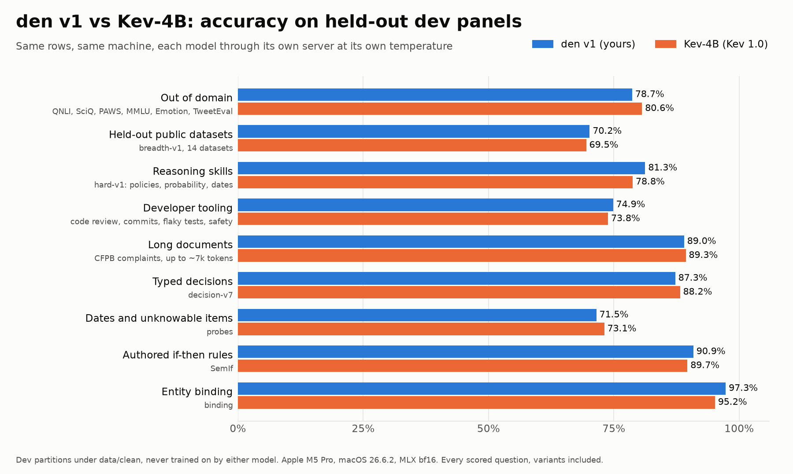
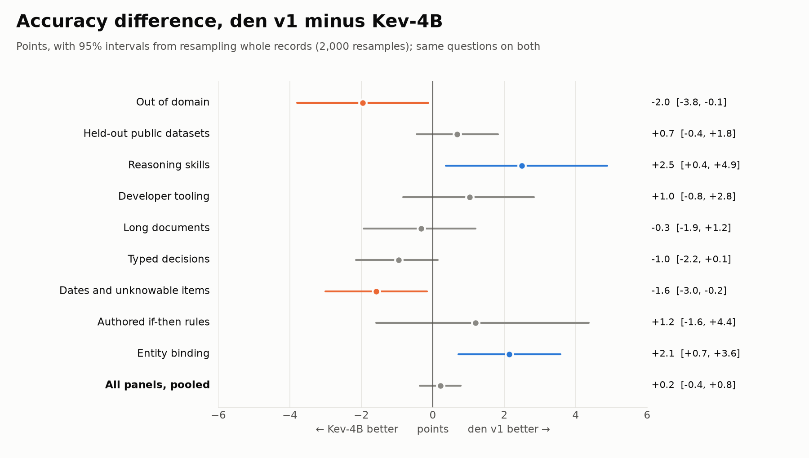
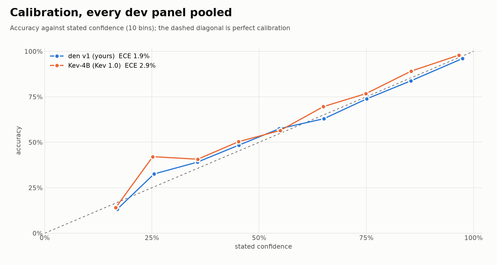
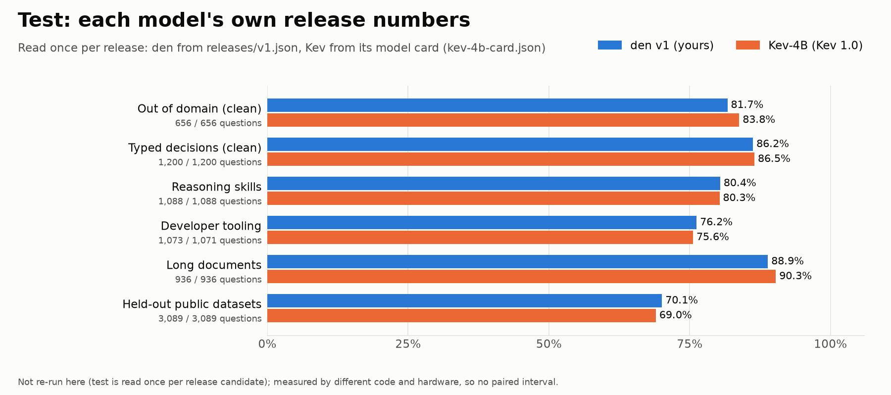

# Benchmarks: den v1 vs Kev-4B

Both are 4B System One models on `Qwen/Qwen3.5-4B-Base`, LoRA rank 16, trained on the same data: Kev's four-stage recipe (`core` → `dates` → `documents` → `skills`+`devtools`) and nothing else. What differs is the model: den's set head (span pooling, cross-option attention, per-option prior) and prompt layout against Kev's pointer head and template. Every panel below is held out from both.

**On dev, pooled over 10,459 questions, den v1 is +0.2 points [-0.4, +0.8] against Kev-4B.** It is ahead with a 95% interval clear of zero on 2 of 9 panels and behind on 2.

<picture><source media="(prefers-color-scheme: dark)" srcset="accuracy-dark.png"></picture>

<picture><source media="(prefers-color-scheme: dark)" srcset="delta-dark.png"></picture>

## Dev panels (measured here)

Each model ran behind its own server (`den serve`; Kev's `kev.serve` from [jaredpalmer/kev](https://github.com/jaredpalmer/kev)) on the same machine (Apple M5 Pro, macOS 26.6.2, MLX, bf16), at its own shipped temperature (den T = 2.18, Kev T = 2.41). `scripts/run_benchmarks.py` sent every record of each pinned dev file under `data/clean/` to both servers, and `den/metrics.py` scored both. Accuracy counts every scored question, including Kev's permuted and contrastive variants. Unknowable items are counted apart (last column).

| Panel | Questions | den acc | Kev acc | Δ pts [95% CI] | den NLL / Brier / ECE | Kev NLL / Brier / ECE | Coverage at ≤5% error, den / Kev |
|---|---:|---:|---:|---|---|---|---|
| Out of domain (`dev/transfer.jsonl`) | 764 | 78.7% | 80.6% | -2.0 [-3.8, -0.1] | 0.531 / 0.290 / 6.2% | 0.460 / 0.254 / 3.3% | 55.5% / 61.9% |
| Held-out public datasets (`dev/breadth.jsonl`) | 3,075 | 70.2% | 69.5% | +0.7 [-0.4, +1.8] | 0.716 / 0.386 / 3.8% | 0.711 / 0.391 / 2.8% | 28.6% / 33.3% |
| Reasoning skills (`dev/skills.jsonl`) | 1,083 | 81.3% | 78.8% | +2.5 [+0.4, +4.9] | 0.526 / 0.280 / 7.6% | 0.574 / 0.311 / 9.7% | 57.4% / 46.7% |
| Developer tooling (`dev/devtools.jsonl`) | 1,074 | 74.9% | 73.8% | +1.0 [-0.8, +2.8] | 0.606 / 0.349 / 5.5% | 0.628 / 0.358 / 7.7% | 34.5% / 32.3% |
| Long documents (`dev/documents.jsonl`) | 920 | 89.0% | 89.3% | -0.3 [-1.9, +1.2] | 0.311 / 0.162 / 2.9% | 0.358 / 0.174 / 9.4% | 81.8% / 85.0% |
| Typed decisions (`dev/core.jsonl`) | 1,468 | 87.3% | 88.2% | -1.0 [-2.2, +0.1] | 0.376 / 0.186 / 3.3% | 0.350 / 0.177 / 1.8% | 79.3% / 81.0% |
| Dates and unknowable items (`dev/probes.jsonl`) | 1,264 | 71.5% | 73.1% | -1.6 [-3.0, -0.2] | 0.696 / 0.359 / 4.9% | 0.646 / 0.335 / 4.2% | 45.3% / 50.6% |
| Authored if-then rules (`dev/semif.jsonl`) | 252 | 90.9% | 89.7% | +1.2 [-1.6, +4.4] | 0.268 / 0.150 / 2.2% | 0.292 / 0.156 / 3.4% | 84.9% / 86.1% |
| Entity binding (`dev/binding.jsonl`) | 560 | 97.3% | 95.2% | +2.1 [+0.7, +3.6] | 0.074 / 0.042 / 1.6% | 0.108 / 0.063 / 1.8% | 100.0% / 100.0% |
| **All dev panels, pooled** | 10,459 | | | **+0.2 [-0.4, +0.8]** | ECE 1.9% | ECE 2.9% | |

Δ is den minus Kev over the same questions. The interval resamples whole records, so questions that share a state move together (`metrics.paired_bootstrap`). Coverage is the share of questions that can be answered, most confident first, while keeping the error rate at 5% or below.

### Kev's clean slices and robustness checks

Kev's cards report suites with variants on their clean rows only. These columns use the same rows (`metrics.robustness`). A permutation flip is a changed answer after the options were reordered (lower is better). A contrastive pair is two states that differ only in the deciding fact, and it counts when both siblings are right (higher is better). Unknowable items have the deciding sentence removed, so a confident answer is a guess (lower is better; the mean top probability is in brackets). Kev's transfer and probes suites share the same 36 permuted rows and 64 contrastive pairs, so those columns repeat across the two.

| Panel | Clean questions | den clean acc | Kev clean acc | den / Kev permutation flips | den / Kev contrastive pairs both right | den / Kev unknowable answered at p ≥ 0.9 |
|---|---:|---:|---:|---|---|---|
| Out of domain | 656 | 79.9% | 81.9% | 2.8% / 5.6% | 75.0% / 81.2% | - / - |
| Typed decisions | 1264 | 86.7% | 87.5% | 3.3% / 1.7% | 93.8% / 93.8% | - / - |
| Dates and unknowable items | 1046 | 75.7% | 77.2% | 2.8% / 5.6% | 75.0% / 81.2% | 0.0% (0.44) / 0.0% (0.46) |
| Authored if-then rules | 144 | 89.6% | 89.6% | - / - | - / - | - / - |

## Calibration

<picture><source media="(prefers-color-scheme: dark)" srcset="calibration-dark.png"></picture>

Both models ship one fitted temperature. A well-calibrated model's 80% answers are right about 80% of the time, which is what makes thresholds such as "automate above 0.9, otherwise send to a person" safe.

## Test (each model's own release numbers)

Test partitions are read once per release candidate (hard rule 1 in `CLAUDE.md`), so they were **not** re-run here. den's numbers come from `releases/v1.json` (CUDA bf16, den's evaluation). Kev's come from its model card (fp32, Kev's evaluation), copied with their sources into `kev-4b-card.json`. The rows and question counts match: where Kev reports clean rows, den's clean slice of the same file is shown. They were measured by different code on different hardware, so no interval is given.

<picture><source media="(prefers-color-scheme: dark)" srcset="test-dark.png"></picture>

| Panel | Questions (den / Kev) | den v1 | Kev-4B | Difference |
|---|---|---:|---:|---:|
| Out of domain (clean) | 656 / 656 | 81.7% | 83.8% | -2.1 pts |
| Typed decisions (clean) | 1,200 / 1,200 | 86.2% | 86.5% | -0.2 pts |
| Reasoning skills | 1,088 / 1,088 | 80.4% | 80.3% | +0.1 pts |
| Developer tooling | 1,073 / 1,071 | 76.2% | 75.6% | +0.6 pts |
| Long documents | 936 / 936 | 88.9% | 90.3% | -1.4 pts |
| Held-out public datasets | 3,089 / 3,089 | 70.1% | 69.0% | +1.1 pts |

## Speed (this machine, one request at a time)

Median latency per request as the client saw it, over the same records. Kev's server caches the state, so the questions after the first reuse it. den reads each question with the state alone, as it was trained.

| Panel | den p50 / p95 ms | Kev p50 / p95 ms |
|---|---:|---:|
| Out of domain | 68 / 159 | 118 / 149 |
| Held-out public datasets | 137 / 1111 | 192 / 630 |
| Reasoning skills | 138 / 2849 | 151 / 1606 |
| Developer tooling | 129 / 419 | 156 / 417 |
| Long documents | 357 / 1464 | 261 / 870 |
| Typed decisions | 73 / 283 | 122 / 327 |
| Dates and unknowable items | 71 / 134 | 118 / 158 |
| Authored if-then rules | 65 / 72 | 113 / 122 |
| Entity binding | 79 / 84 | 126 / 130 |

## Reproduce

```bash
uv run den serve --run hf:ramput-labs/den-4b@v1                                    # :8009
git clone https://github.com/jaredpalmer/kev && cd kev
git checkout fe64b1274ea7f80d4095866df90666abb03e9cf6
uv sync --extra serve && uv run --extra serve python -m kev.serve --run jaredpalmer/kev-4b@139fdd94f1b6a6ad80cc15e08fcb99cac885a101   # :8008
uv run python -m scripts.run_benchmarks --model kev-4b=http://127.0.0.1:8008 --model den-v1=http://127.0.0.1:8009 --baseline kev-4b
uv run python -m scripts.plot_benchmarks
```

Measured 2026-10-11T15:39:18Z at commit `5019c013b5ac577b9c7ae3c86e851d56bb1f36e8+dirty`. den served `den-latest` (qwen3.5-4b + LoRA r16 + set head (one forward pass, calibrated T=2.18)). Kev served `jaredpalmer/kev-4b@139fdd94f1b6a6ad80cc15e08fcb99cac885a101`. `results.json` holds every metric, the sha256 of every scored file and both servers' `/v1/models`. `predictions/` holds each question's probabilities from both models.
